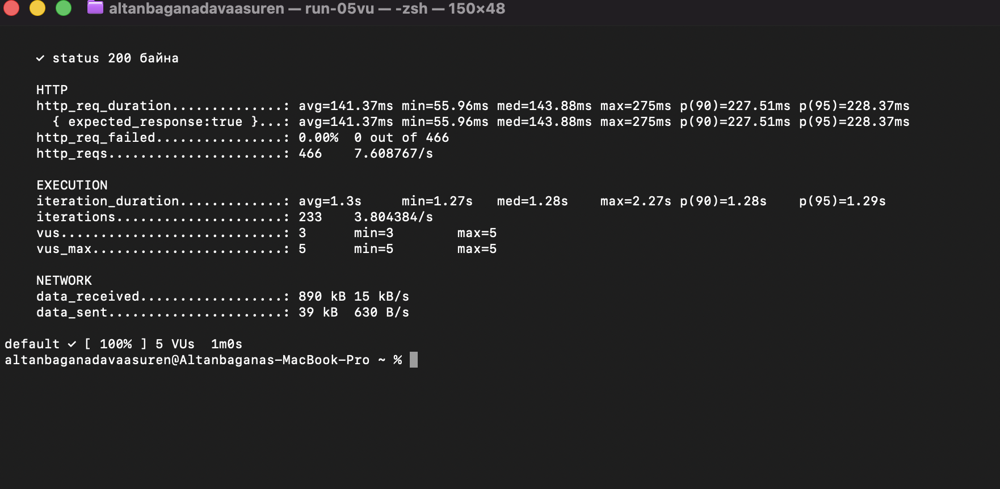
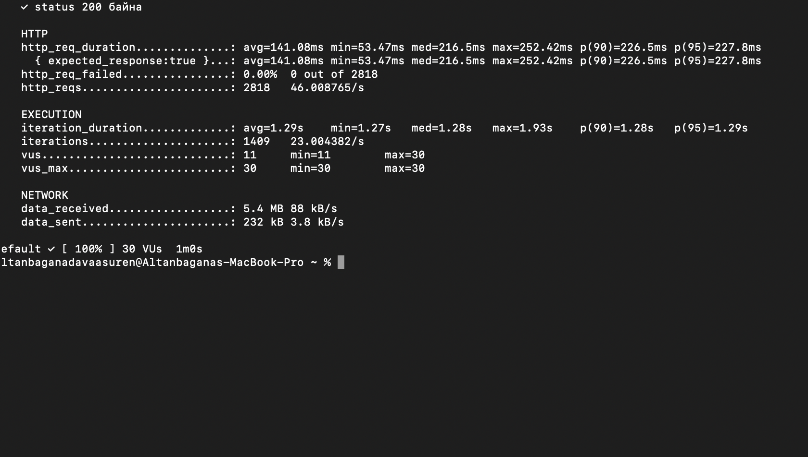
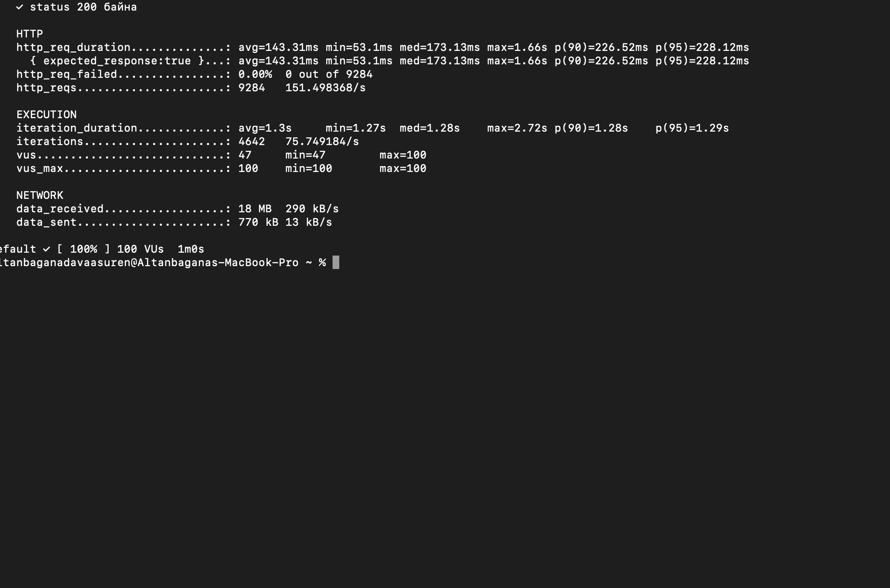
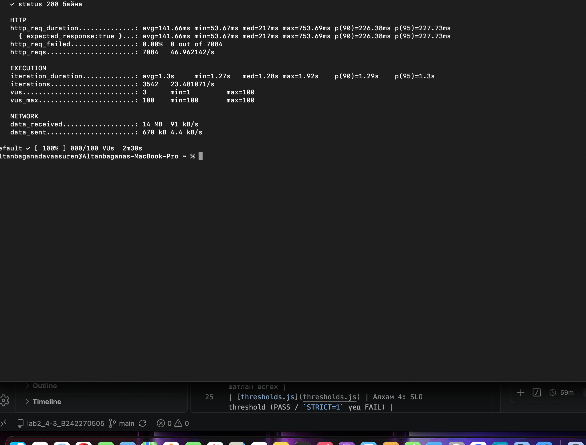
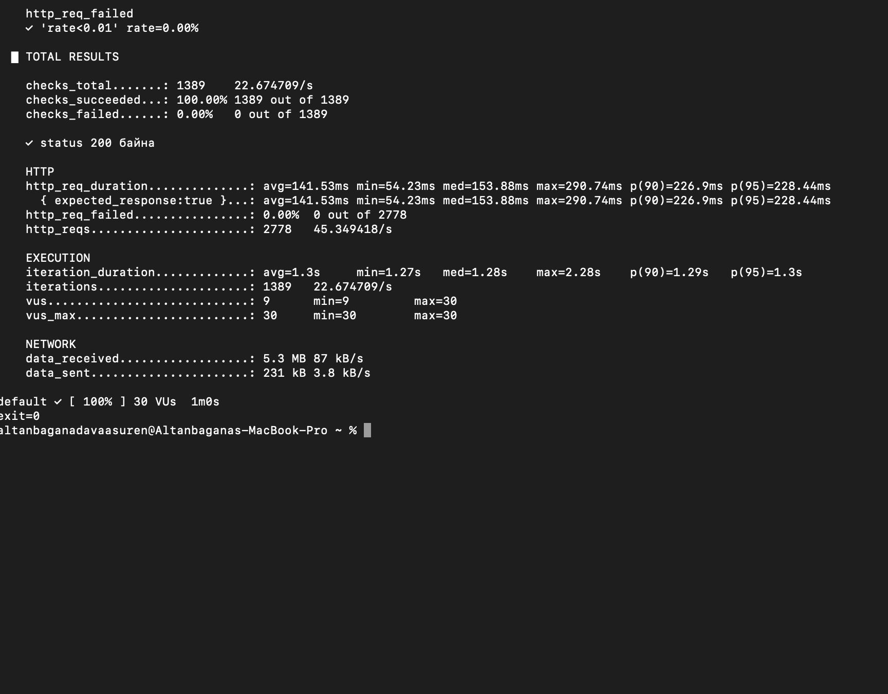
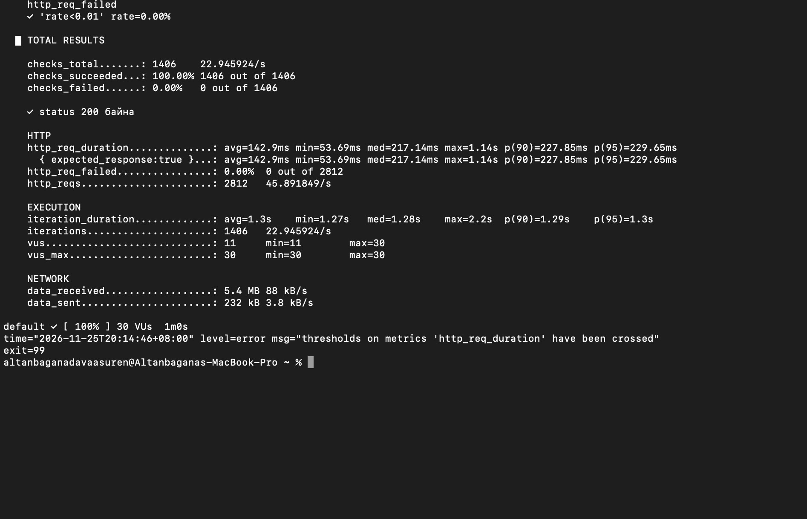
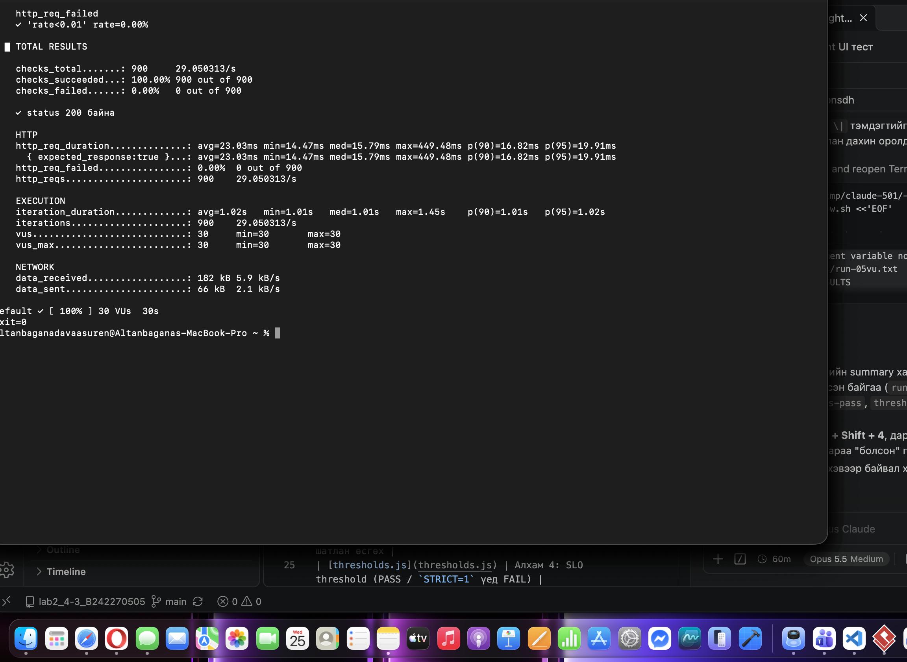
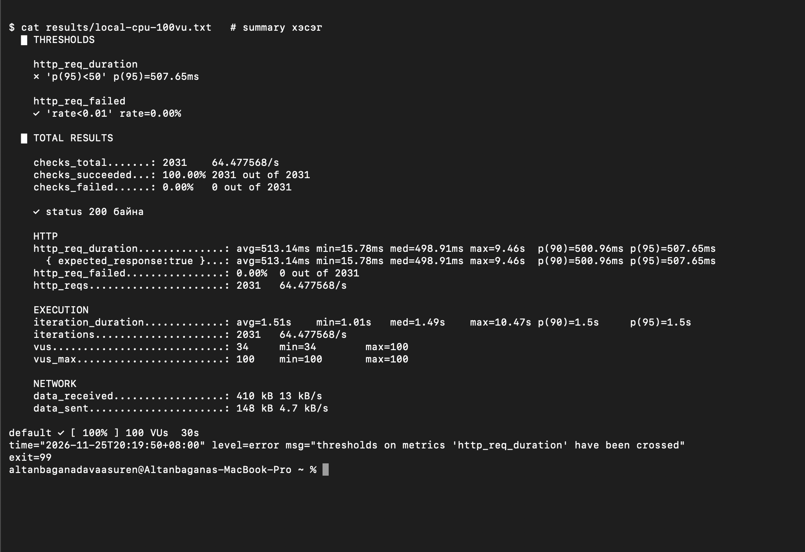

# Лаборатори №2: Гүйцэтгэлийн хэмжүүрийг k6-аар хэмжих

**F.CSA313 — Программ хангамжийн чанарын баталгаа ба тест (2026)**
Оюутан: B242270505

## Орчин

```
$ k6 version
k6 v2.4.0 (commit/devel, go1.27.4, darwin/arm64)
```

macOS (Apple Silicon) дээр `brew install k6` командаар суулгасан ([results/k6-version.txt](results/k6-version.txt)).

**Бай (target):** зөвхөн зөвшөөрөгдсөн бай руу тестлэсэн.
- `https://test.k6.io` — албан ёсны дадлагын сайт. Одоо `https://quickpizza.grafana.com` руу `302` redirect хийдэг (Grafana-ийн албан ёсны дадлагын сайт). Тиймээс нэг iteration-д 2 HTTP хүсэлт гарч, `http_reqs` нь `iterations`-ийн 2 дахин их байна.
- `http://localhost:3000` — өөрийн бичсэн локал Node сервер ([server/server.js](server/server.js)).

## Файлууд

| Файл | Зорилго |
|---|---|
| [script.js](script.js) | Алхам 2: үндсэн тест (5 VU, 30s). Алхам 3-ын 5/30/100 VU хэмжилтэд `--vus` flag-тай ашигласан |
| [stages.js](stages.js) | Алхам 3: 5→30→100→0 VU шатлан өсгөх |
| [thresholds.js](thresholds.js) | Алхам 4: SLO threshold (PASS / `STRICT=1` үед FAIL) |
| [server/server.js](server/server.js), [local.js](local.js) | Алхам 5: локал сервер ба түүн рүү хийх тест |
| [results/](results/) | k6-ийн **бүтэн** текст гаралтууд |
| [screenshots/](screenshots/) | Summary-ийн дэлгэцийн зургууд |

## Алхам 2: Baseline

`k6 run script.js` (5 VU, 30s) → [results/baseline-05vu-30s.txt](results/baseline-05vu-30s.txt)

| Хэмжүүр | Утга | Утга нь |
|---|---|---|
| `http_req_duration` avg | 140.68ms | Дундаж хариу өгөх хугацаа |
| `http_req_duration` p90 | 225.86ms | Хүсэлтийн 90% нь үүнээс хурдан |
| `http_req_duration` p95 | 227.19ms | Хүсэлтийн 95% нь үүнээс хурдан |
| `http_reqs` | 232 (7.42/s) | Throughput |
| `http_req_failed` | 0.00% (0 / 232) | Error rate (POFOD-ийн аналог) |

Хүснэгт болон SLO-д 1 минутын хэмжилтийг ашигласан: **5 VU-ийн p95 = 228.37ms** ([run-05vu.txt](results/run-05vu.txt)). Энэ бол миний **BASELINE**.

## Алхам 3: 5 / 30 / 100 VU (test.k6.io)

`k6 run --vus N --duration 1m script.js`. Түвшин бүрийг **тусад нь** ажиллуулсан.

| VU | p90 | p95 | max | Throughput (http_reqs/s) | Нийт хүсэлт | Error rate | Файл |
|---|---|---|---|---|---|---|---|
| 5 | 227.51ms | 228.37ms | 275ms | 7.61/s | 466 | 0.00% | [run-05vu.txt](results/run-05vu.txt) |
| 30 | 226.5ms | 227.8ms | 252.42ms | 46.01/s | 2818 | 0.00% | [run-30vu.txt](results/run-30vu.txt) |
| 100 | 226.52ms | 228.12ms | 1.66s | 151.50/s | 9284 | 0.00% | [run-100vu.txt](results/run-100vu.txt) |





**Stages** (`k6 run stages.js`, [results/stages.txt](results/stages.txt)): нийт 7084 хүсэлт (46.96/s), p95 = 227.73ms, max = 753.69ms, error 0.00%. Нэгтгэсэн summary нь түвшин бүрийн ялгааг "дарж" харуулдаг. Max (753ms) л оргил үед гацаа гарсныг илтгэж байна.



## Алхам 4: Thresholds (SLO)

**SLO:** `p(95) < 350ms` ба `http_req_failed rate < 1%`.

**Үндэслэл:** baseline p95 = 228.37ms × 1.5 ≈ 343ms гарсныг 350ms болгож бөөрөнхийлсөн. Ачаалал 6 дахин (5 → 30 VU) өсөхөд хэрэглэгч baseline-аас 50%-иас илүү удаашрал мэдрэх ёсгүй гэсэн шаардлагыг илэрхийлнэ. 230ms орчим latency-ийн дийлэнх нь гадаад сервер хүртэлх сүлжээ ба TLS-ээс бүрддэг тул үүнээс бага утга тавих нь бодитой биш.

| Ажиллуулалт | Threshold | Үр дүн | Exit code | Файл |
|---|---|---|---|---|
| `k6 run thresholds.js` (30 VU, 1m) | `p(95)<350` | ✓ p(95)=228.44ms → **PASS** | 0 | [thresholds-pass.txt](results/thresholds-pass.txt) |
| `k6 run -e STRICT=1 thresholds.js` | `p(95)<50` (санаатай хатуу) | ✗ p(95)=229.65ms → **FAIL** | 99 | [thresholds-fail.txt](results/thresholds-fail.txt) |

Threshold зөрчигдвөл k6 `exit code 99`-өөр дуусна. CI pipeline (GitHub Actions г.м.) үүнийг алдаа гэж үзэж build-ийг зогсоодог. Quality gate яг ийм зарчмаар ажилладаг.




## Алхам 5: Локал сервер (нэмэлт гүнзгийрэл)

[server/server.js](server/server.js) нь гадаад сангүй, цэвэр Node.js сервер:
- `/fast`: шууд хариулна.
- `/slow`: `setTimeout`-оор 100ms хүлээнэ. Энэ нь I/O хүлээлт бөгөөд event loop-ыг блоклохгүй.
- `/cpu`: 15ms CPU тооцоолол хийнэ. Event loop-ыг блоклох тул онолын хүчин чадал нь ≈ 1000/15 ≈ **66 req/s**.

`node server/server.js`, дараа нь `k6 run -e EP=<endpoint> --vus N --duration 30s local.js`

| Endpoint | VU | p90 | p95 | max | Throughput | Error rate | Threshold |
|---|---|---|---|---|---|---|---|
| /fast | 5 | 2.31ms | 2.7ms | 3.12ms | 4.98/s | 0.00% | PASS |
| /fast | 30 | 3.77ms | 5.1ms | 8.12ms | 29.91/s | 0.00% | PASS |
| /fast | 100 | 5.16ms | 6.6ms | 9.48ms | 99.64/s | 0.00% | PASS |
| /slow | 5 | 102.86ms | 103.17ms | 103.51ms | 4.53/s | 0.00% | PASS |
| /slow | 30 | 104.37ms | 106.01ms | 137.31ms | 27.10/s | 0.00% | PASS |
| /slow | 100 | 105.55ms | 106.16ms | 108.2ms | 90.53/s | 0.00% | PASS |
| /cpu | 5 | 17.11ms | 27.27ms | 76.05ms | 4.90/s | 0.00% | PASS |
| /cpu | 30 | 16.82ms | 19.91ms | 449.48ms | 29.05/s | 0.00% | PASS |
| /cpu | 100 | **500.96ms** | **507.65ms** | **9.46s** | **64.48/s** | 0.00% | **FAIL** (exit 99) |

Бүтэн гаралт: [results/local-*.txt](results/).




## Дүгнэлт

test.k6.io дээр VU 5 → 30 → 100 болж өсөхөд throughput 7.61 → 46.01 → 151.50 req/s болж бараг шугаман өссөн. Харин p95 latency ~228ms хэвээр үлдсэн. Энэ нь сайт CDN болон хэвтээ тэлэлттэй (horizontal scaling) тул 100 VU түүний хүчин чадлын хязгаарт хүрээгүйг харуулж байна. Гэсэн хэдий ч 100 VU үед **max latency 275ms → 1.66s** болж үсэрсэн. Дундаж болон p95 "сайн" харагдаж байсан ч зарим хэрэглэгч 1.6 секунд хүлээсэн. Энэ нь лекцийн "дундаж биш, tail latency (p95/p99/max)-ийг хар" гэсэн санааг баталж байна. Лекцийн throughput ба latency-ийн зөрчил локал серверийн `/cpu` endpoint дээр тод харагдсан. 30 VU хүртэл throughput ачааллын хэрээр өсөж, p95 20ms орчим байсан. 100 VU үед throughput **64.48 req/s** буюу онолын хүчин чадал (~66 req/s) дээрээ зогсож, p95 **507.65ms** (25 дахин), max **9.46s** болсон. Өөрөөр хэлбэл системийн хүчин чадал хангагдсан цэгээс хойш нэмэлт ачаалал throughput-ийг өсгөхгүй, зөвхөн дараалал (queue) үүсгэж хэрэглэгч бүрийн хүлээх хугацааг нэмдэг. "Нэгж хэрэглэгчийн туршлага" муудаж эхэлсэн цэг нь `/cpu`-ийн хувьд 30–100 VU-ийн хооронд, санал болгосон ачаалал ~66 req/s-ийг давсан үе юм. Ижил 100 VU-д `/slow` (100ms I/O хүлээлт) огт муудаагүй. Үүнээс event loop-ыг блоклодог CPU ажил ба блоклодоггүй I/O хүлээлтийн ялгаа гүйцэтгэлд шийдвэрлэх нөлөөтэйг харлаа. Бүх ажиллуулалтад error rate 0.00% байсан тул availability хангагдсан. Гэхдээ "алдаагүй" нь "хурдан" гэсэн үг биш, хоёуланг нь тусад нь хэмжих хэрэгтэйг ойлгосон. Миний SLO (`p95<350ms`, error `<1%`) test.k6.io дээр 30 VU-д хангагдсан (p95 = 228.44ms, PASS). Санаатай хатуу `p95<50ms` нь FAIL (exit 99) болж, threshold нь CI-д quality gate болж чадахыг харууллаа.

## Нэмэлт: AI өнцөг

Скриптүүдийг AI туслах (Claude) ашиглан бичсэн. Ажиллуулахаас өмнө бүх бай URL-ыг шалгаж, зөвхөн `test.k6.io` болон `localhost:3000` байгааг баталгаажуулсан. AI зааврын жишээ `p(95)<300`-г шууд хуулалгүй, baseline-аас тооцож SLO-г санал болгосон. Гэхдээ `test.k6.io` redirect хийдгийг (нэг iteration-д 2 хүсэлт) хэмжилтийн дараа л олж мэдсэн. Мөн гадаад сайт дээр latency-ийн муудал харагдахгүй байсан тул локал CPU endpoint нэмж байж лекцийн үзэгдлийг харуулж чадсан. Энэ нь AI-ийн таамаглалыг бодит хэмжилтээр шалгах хэрэгтэйг харуулж байна.

> Тэмдэглэл: дэлгэцийн зургууд нь macOS Terminal дээр `results/` доторх k6 гаралтын summary хэсгийг харуулж авсан жинхэнэ screenshot-ууд. Тоонууд нь текст файлтай яг ижил.
